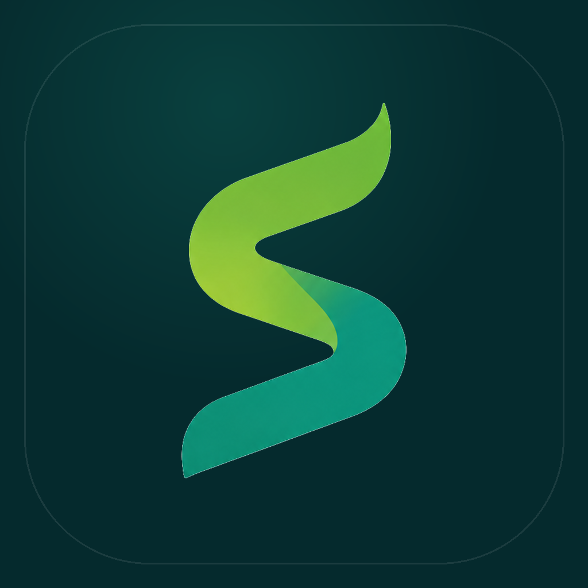

<div align="center">

  

  <br />

  

  <p align="center">
    <strong>The Calm Financial Companion & Payday Safety Runway</strong>
  </p>

  <p align="center">
    <em>Know exactly what’s safe to spend before payday. Connecting shifts, salary, bills, and savings into one calm runway.</em>
  </p>

  <p align="center">
    <a href="https://play.google.com/store/apps/details?id=com.stedflo.app">
      
    </a>
    <a href="#-mobile-availability">
      
    </a>
    <a href="#-tech-stack">
      
    </a>
    <a href="#-brand-color-system">
      
    </a>
    
  </p>

</div>

---

### 🌿 Table of Contents

- [✨ Overview & Core Philosophy](#-overview--core-philosophy)
- [🎨 Brand Color System](#-brand-color-system)
- [📱 Key Features](#-key-features)
- [📐 Page Architecture](#-page-architecture)
- [🛠️ Tech Stack](#️-tech-stack)
- [🚀 Quick Start & Development](#-quick-start--development)
- [📦 Project Directory Structure](#-project-directory-structure)
- [🔐 Privacy & Security Guarantees](#-privacy--security-guarantees)
- [📲 Mobile Availability](#-mobile-availability)
- [📬 Support & Contact](#-support--contact)

---

### ✨ Overview & Core Philosophy

Unlike traditional budgeting apps that guilt-trip you with retrospective pie charts after money has already been spent, **Stedflo** is predictive, calm, and forward-looking.

```
┌────────────────────────────────────────────────────────────────────────┐
│                        THE STEDFLO EQUATION                            │
│                                                                        │
│   Income - (Upcoming Bills + Savings Buffer)                           │
│   ────────────────────────────────────────── = Daily Safe-to-Spend     │
│              Days Until Next Payday                                    │
└────────────────────────────────────────────────────────────────────────┘
```

- **🟢 Real-Time Payday Safety Runway**: Deducts future rent, bills, and emergency cushions before computing what is safe to spend today.
- **⚡ Variable Income Engine**: Built specifically for hourly shift workers (day/night differentials), contractors & freelancers (milestone payouts & tax buffers), and salaried professionals.
- **🛡️ Automated Bill Ring-Fencing**: Keeps mandatory commitments untouchable so they are never accidentally spent on casual expenses.

---

### 🎨 Brand Color System

Stedflo uses a calming, high-contrast forest & lime fintech palette inspired by modern finance platforms like Cash App, Monzo, and Linear:

| Swatch | Color Name | Hex Code | Purpose & Application |
| :---: | :--- | :--- | :--- |
|  | **Deep Midnight Ink** | `#102629` | Hero depth, chassis framing, dark card gradients |
|  | **Ink (Primary Dark)** | `#173539` | Primary headings, dark buttons, wordmarks, footer |
|  | **Forest Teal** | `#234E53` | Secondary highlights, card borders, active states |
|  | **Forest Teal Light** | `#36656B` | Section sub-accents, wavy underlines, tags |
|  | **Leaf Green** | `#4E9B56` | Checkmarks, positive metrics, trust badges |
|  | **Leaf Green Light** | `#75B06F` | Secondary rings, category labels, subtle accents |
|  | **Radiant Lime Glow** | `#B7EF4A` | Accent highlights, gauge needle, safety score ring |
|  | **Pale Glow** | `#F0F8A4` | Soft radial backdrops, ambient glows |
|  | **Warm Soft Mist** | `#F7F9F3` | Primary page canvas background |
|  | **Muted Body Text** | `#5E7875` | Explanatory copy, captions, timestamps |

---

### 📱 Key Features

- **1. Payday Safety Runway**  
  Calculates true daily disposable balance by ring-fencing upcoming commitments.
- **2. Shift & Hourly Tracking**  
  Log hours, overtime rates, and night differentials with auto-projected net take-home.
- **3. Smart Bill Reminders**  
  Proactive notifications 5 days and 2 days before subscriptions and utilities hit.
- **4. Frictionless Savings Goals**  
  Visual progress rings that steadily build emergency cushions without starving your lifestyle.
- **5. Tax Planning & Net Take-Home**  
  Pre-calculates withholding tax reserves for freelancers and contractors to eliminate filing shock.
- **6. Bank-Grade Security & Privacy**  
  Cryptographic password hashing, on-device keystore protection, and zero data selling.

---

### 📐 Page Architecture

```
┌────────────────────────────────────────────────────────────────────────┐
│ 1. Sticky Navigation (Official Dark Logo · Nav Links · Store CTAs)     │
├────────────────────────────────────────────────────────────────────────┤
│ 2. Hero Section (Calm Value Prop · Dual Store Badges · Interactive UI) │
│    └─ Interactive Phone Mockup with Live Safe-to-Spend Simulator       │
├────────────────────────────────────────────────────────────────────────┤
│ 3. Quantitative Trust Proof Strip (KES 48.2M+ Protected · 4.8★ Rating) │
├────────────────────────────────────────────────────────────────────────┤
│ 4. "The Stedflo Difference" (Side-by-Side Comparison Matrix)           │
├────────────────────────────────────────────────────────────────────────┤
│ 5. 6 Core Feature Pillars (with Official Vector Illustrations)         │
├────────────────────────────────────────────────────────────────────────┤
│ 6. Interactive Persona Switcher (Hourly · Freelance · Salaried)        │
├────────────────────────────────────────────────────────────────────────┤
│ 7. How It Works (3-Step Setup & The Core Equation)                     │
├────────────────────────────────────────────────────────────────────────┤
│ 8. Interactive FAQ Accordion (ARIA-Accessible · Smooth Collapse)       │
├────────────────────────────────────────────────────────────────────────┤
│ 9. High-Impact Bottom CTA Banner (Midnight Ink Gradient & Lime Glow)   │
├────────────────────────────────────────────────────────────────────────┤
│ 10. Footer (Horizontal White Logo · Legal · Support: support@stedflo)  │
└────────────────────────────────────────────────────────────────────────┘
```

---

### 🛠️ Tech Stack

- **⚡ Framework**: React 19 + TypeScript
- **🎨 Styling**: Tailwind CSS v4 (with `@theme` CSS variable bindings)
- **🔤 Typography**: Google Font *Plus Jakarta Sans* & *JetBrains Mono*
- **✨ Icons**: Lucide React
- **⚡ Tooling**: Vite 8 + ESBuild

---

### 🚀 Quick Start & Development

#### Prerequisites
- Node.js `20.x` or later
- npm or pnpm

#### 1. Clone & Install Dependencies
```bash
git clone https://github.com/your-username/stedflo-landing.git
cd stedflo-landing
npm install
```

#### 2. Start the Development Server
```bash
npm run dev
```
The application will launch at `http://localhost:3000`.

#### 3. Build for Production
```bash
npm run build
```

#### 4. Type Checking & Verification
```bash
npm run lint
```

---

### 📦 Project Directory Structure

```
├── public/
│   └── assets/
│       └── aistudio/
│           ├── stedflo-app-icon_2838e1d9.png             # Official App Icon
│           ├── stedflo-logo-horizontal_b2058b01.png       # Dark Wordmark (Header)
│           ├── stedflo-logo-horizontal-white_19fe58b6.png # White Wordmark (Footer)
│           ├── finance_c491e411.svg                       # Tax & Runway Illustration
│           ├── schedule_d51ab499.svg                      # Shift Tracking Illustration
│           └── SmartphoneApplicationFeatures_a310831c.svg # Mobile Features Illustration
├── src/
│   ├── components/
│   │   ├── Navbar.tsx             # Sticky 3-zone header & mobile drawer
│   │   ├── Hero.tsx               # Hero split + interactive phone simulator
│   │   ├── TrustProofStrip.tsx    # Quantitative proof metrics
│   │   ├── DifferenceSection.tsx  # Traditional vs Stedflo comparison
│   │   ├── FeaturePillars.tsx     # 6 Bento feature cards with illustrations
│   │   ├── PersonaSwitcher.tsx    # Shift, freelance & salaried preview cards
│   │   ├── HowItWorks.tsx         # 3-step setup walkthrough
│   │   ├── FaqSection.tsx         # Collapsible FAQ accordion
│   │   ├── CtaBanner.tsx          # High-impact bottom download banner
│   │   ├── Footer.tsx             # Site map, legal links & support email
│   │   ├── IosWaitlistModal.tsx   # Interactive iOS notification dialog
│   │   └── PrivacyModal.tsx       # Zero-data-selling constitution modal
│   ├── types/
│   │   └── index.ts               # TypeScript interfaces
│   ├── App.tsx                    # Main landing page composition
│   ├── index.css                  # Tailwind v4 theme & radial glow utilities
│   └── main.tsx                   # React root entry point
├── index.html                     # HTML head, Plus Jakarta Sans, OpenGraph
├── metadata.json                  # AI Studio project configuration
├── package.json                   # Dependencies and scripts
├── tsconfig.json                  # Strict TypeScript configuration
└── vite.config.ts                 # Vite bundler configuration
```

---

### 🔐 Privacy & Security Guarantees

- **🛡️ Zero Ad-Broker Tracking**: We will never sell, rent, or monetize your financial data to third-party brokers, advertisers, or loan solicitors.
- **🔒 AES-256 On-Device Keystore**: All local tokens and shift logs are protected by hardware-backed Android Keystore and Apple Secure Enclave.
- **✨ Complete Data Sovereignty**: Export your financial logs to CSV at any time or purge your account permanently with one click.

---

### 📲 Mobile Availability

- **Google Play Store (Android)**: [Live Listing on Google Play](https://play.google.com/store/apps/details?id=com.stedflo.app)
- **Apple App Store (iOS)**: In active store review for Q1 2026. Join the priority waitlist via the landing page to receive early TestFlight access.

---

### 📬 Support & Contact

- **📧 Support Email**: [support@stedflo.com](mailto:support@stedflo.com)
- **🌐 Website**: [stedflo.com](https://stedflo.com)
- **© 2026 Stedflo**. All rights reserved.
